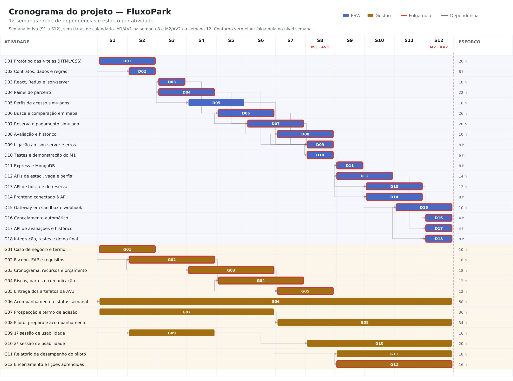
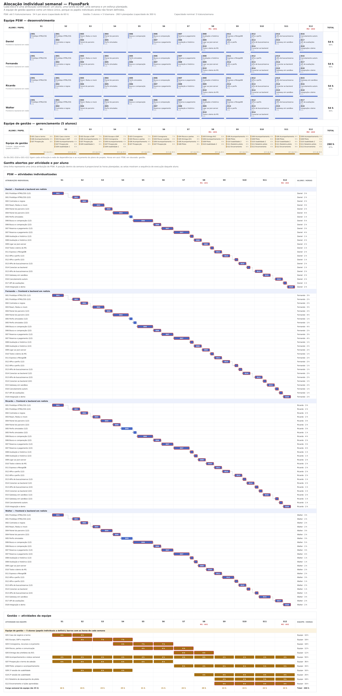
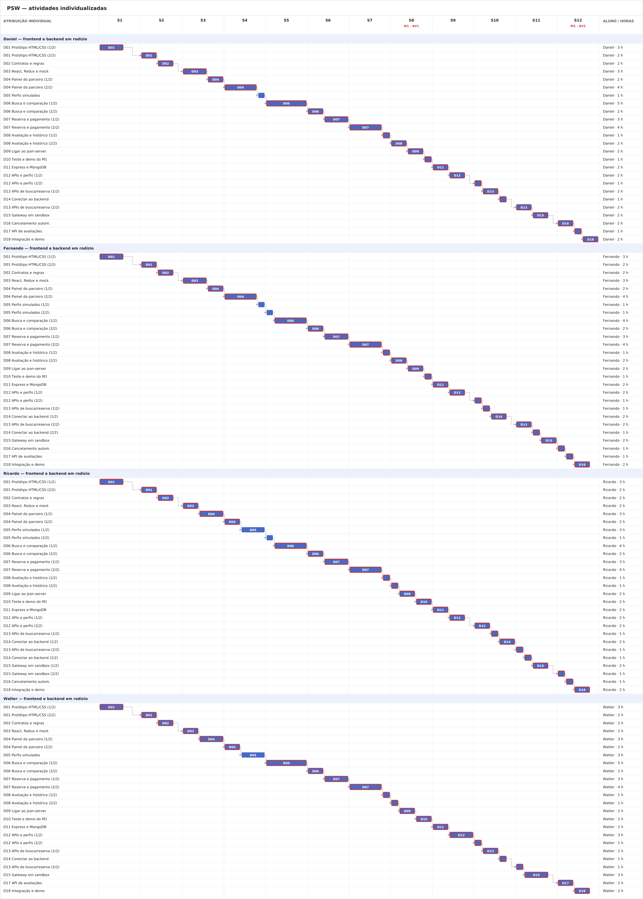
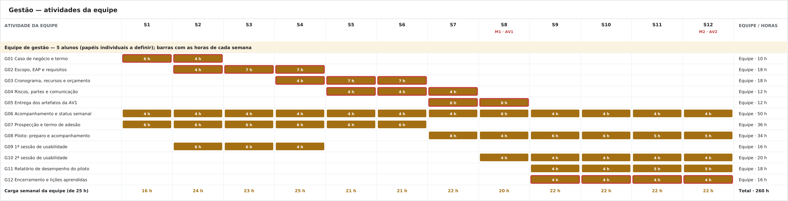

# Plano de Projeto — FluxoPark

**Versão:** 2.0 — alinhado ao termo de abertura de 3 meses (12 semanas), com frontend até a AV1 e backend depois
**Data:** 04/10/2026
**Patrocinador:** Prof. Diogo Silveira Mendonça (CEFET/RJ)
**Gerente do projeto:** Ana Clara dos Santos Morais
**Equipe:** 5 alunos de gestão (Ana Clara dos Santos Morais, Beatriz Manhães, Juan Mendes, Manuela Ribeiro e Maria Luisa Santiago) e 4 alunos de PSW (Daniel Rimes, Fernando Barbosa, Ricardo Franco e Walter dos Santos)

> Este documento contém a declaração do escopo, os requisitos, a matriz de rastreabilidade, a EAP, o cronograma, os recursos, os custos, os riscos e o engajamento. O dicionário da EAP, com o aceite de cada pacote, está em [dicionario-eap-fluxopark.md](dicionario-eap-fluxopark.md). O termo de abertura e o caso de negócio estão em documentos separados. Os cinco alunos de gestão ainda não têm papéis individuais definidos; por isso, as atividades de gestão são atribuídas à equipe, e a gerente do projeto é a única pessoa nomeada.

**Números da linha de base**

| O quê | Valor | Onde |
|---|---:|---|
| Iniciação | Faixa de R\$ 20 mil a R\$ 35 mil, com a hora a R\$ 50; o plano de 6 meses previa 500 h e R\$ 25.000 nos pacotes técnicos | Termo 10 |
| Capacidade dos calendários | 240 h PSW + 300 h gestão = 540 h | 5.3 |
| Atividades niveladas | 216 h PSW + 260 h gestão = 476 h, R\$ 8.568,00 | 5.2, 6.2 |
| Segunda estimativa, pelo entregável | 412 h; PSW −4 h, gestão −60 h | 6.2.1 |
| Contingência, por evento nomeado | 64 h = 24 h PSW + 40 h gestão, R\$ 1.152,00 | 6.3.3 |
| Linha de base de custos | 540 h, R\$ 9.720,00 | 6.4 |
| Reserva gerencial, fora da linha de base | 7%, R\$ 680,40 | 6.4 |
| Orçamento total simulado | R\$ 10.400,40; desembolso R\$ 0 | 6.4, termo 10 |
| Marcos | M1/AV1 na semana 8; M2/AV2 na semana 12 | 5.1 |

## 1. Objetivo da EAP

Decompor o trabalho e as entregas do MVP em componentes gerenciáveis, cobrindo os casos de uso informados. A EAP é orientada a entregas; a numeração representa a relação hierárquica, não uma sequência de execução. A ordem de execução está no cronograma (seção 5).

O produto é um MVP acadêmico em duas etapas. Até a AV1 só se implementa o frontend, sobre `json-server`. Depois da AV1 só se implementam o backend e a integração. Os alunos de PSW se revezam entre as duas etapas: nenhum fica restrito a uma única tecnologia. As regras do MVP são hipóteses da equipe, a validar com o parceiro do piloto; não são regras de nenhum estacionamento específico.

Os itens com três níveis, como 1.4.1, são pacotes de trabalho. As atividades do cronograma usam os IDs D01 a D18 (PSW) e G01 a G12 (gestão) e se ligam a um ou mais pacotes na coluna "Pacote" da seção 5.2. Aceite, fronteira e responsável por prestar contas estão no dicionário, não nesta árvore.

## 2. EAP / WBS

### 1.0 Projeto FluxoPark

- **1.1 Gestão e coordenação do projeto**
  - 1.1.1 Termo de abertura e caso de negócio mantidos
  - 1.1.2 Cronograma, orçamento, riscos, decisões e mudanças acompanhados
  - 1.1.3 Demonstrações e aceites dos marcos registrados
  - 1.1.4 Prospecção, termo de adesão e acompanhamento dos parceiros do piloto conduzidos
  - 1.1.5 Sessões de usabilidade com motoristas conduzidas

- **1.2 Requisitos e desenho**
  - 1.2.1 Requisitos levantados e matriz de rastreabilidade mantida
  - 1.2.2 Protótipo das 4 telas em HTML e CSS definido
  - 1.2.3 Modelo de dados e contratos (payloads) definidos
  - 1.2.4 Regras de negócio do MVP documentadas (tolerância, bloqueio de vaga, trava de 90%, avaliação)

- **1.3 Base técnica e ambientes**
  - 1.3.1 Aplicação React com Redux inicializada
  - 1.3.2 `json-server` configurado com dados fictícios de estacionamento, vaga, reserva e avaliação
  - 1.3.3 API Express inicializada
  - 1.3.4 MongoDB configurado para desenvolvimento
  - 1.3.5 Credenciais do gateway em *sandbox* e serviço de mapas obtidos

- **1.4 Marco 1 — Frontend dos fluxos priorizados, com `json-server`**
  - 1.4.1 Painel do parceiro construído (estacionamento, vaga, tarifa e reservas recebidas)
    - 1.4.1.1 Cadastrar, consultar, editar e remover estacionamento
    - 1.4.1.2 Cadastrar, consultar, editar e remover vaga
    - 1.4.1.3 Consultar e cancelar reservas recebidas
  - 1.4.2 Perfis de acesso simulados (Cliente, Estacionamento, Administrador)
  - 1.4.3 Busca e comparação em mapa construídas
    - 1.4.3.1 Pesquisar destino
    - 1.4.3.2 Comparar estacionamentos por preço, distância, horário e disponibilidade
  - 1.4.4 Reserva e pagamento simulado construídos
    - 1.4.4.1 Escolher vaga e período de permanência
    - 1.4.4.2 Exibir a regra de tolerância antes da confirmação
    - 1.4.4.3 Simular pagamento via PIX ou cartão e confirmar a reserva
  - 1.4.5 Avaliação pós-uso e histórico de reservas construídos
  - 1.4.6 Fluxos de frontend conectados ao `json-server`
  - 1.4.7 Demonstração do M1 e limitações do mock documentadas

- **1.5 Backend e regras de negócio**
  - 1.5.1 API de estacionamento e vaga implementada
  - 1.5.2 API de perfis e controle de acesso implementada
  - 1.5.3 API de busca e comparação implementada
  - 1.5.4 API de reserva implementada
    - 1.5.4.1 Bloqueio exclusivo da vaga durante o período reservado
    - 1.5.4.2 Trava de novas reservas online com 90% da capacidade ocupada
    - 1.5.4.3 Cancelamento automático por estouro de tolerância
  - 1.5.5 Integração do gateway PIX/cartão em *sandbox*, com confirmação por *webhook* e simulador
  - 1.5.6 API de avaliações e histórico implementada
  - 1.5.7 Dados de domínio persistidos no MongoDB

- **1.6 Marco 2 — Sistema integrado ao backend próprio**
  - 1.6.1 Frontend conectado à API Express, sem `json-server`
  - 1.6.2 Fluxos completos persistidos e recuperados do MongoDB
  - 1.6.3 Erros e estados inválidos tratados nos fluxos prioritários
  - 1.6.4 Demonstração integrada final preparada

- **1.7 Verificação e encerramento**
  - 1.7.1 Testes dos fluxos prioritários executados
  - 1.7.2 Defeitos tratados ou registrados como limitação conhecida
  - 1.7.3 Instruções de execução documentadas
  - 1.7.4 Relatório de desempenho do piloto elaborado
  - 1.7.5 Termo de encerramento e lições aprendidas registrados

A numeração desta EAP substitui a da versão anterior, que agrupava o desenvolvimento em 1.4.1 a 1.4.7 por funcionalidade e não separava as duas etapas.

## 3. Regras de negócio do MVP

As regras abaixo são hipóteses do MVP acadêmico, a confirmar com o parceiro do piloto. Não devem ser apresentadas como política de nenhum estacionamento.

1. **Preço:** o valor da vaga é fixo e definido pelo parceiro. Não há preço dinâmico.
2. **Reserva:** o motorista reserva uma vaga específica por um período de permanência que ele define. A vaga fica bloqueada exclusivamente para ele durante o período.
3. **Confirmação:** a reserva só é confirmada depois do retorno de sucesso do gateway, por *webhook*, ou de uma simulação válida em *sandbox*. Antes disso, o status é de reserva pendente.
4. **Tolerância:** a tolerância de chegada é de 30 minutos. Sem *check-in* nesse prazo, a reserva é cancelada e a vaga é liberada. A tolerância de saída segue a mesma lógica e deve ser exibida ao motorista antes da confirmação; seu valor é hipótese a confirmar com o parceiro.
5. **Trava de ocupação:** quando a ocupação do estacionamento atinge 90% da capacidade cadastrada, novas reservas online são bloqueadas automaticamente.
6. **Disponibilidade:** no piloto, o parceiro atualiza as vagas manualmente. Essa limitação é conhecida e documentada.
7. **Avaliação:** só é possível avaliar depois de uma reserva concluída. A avaliação tem nota de 1 a 5 e comentário, e a nota média aparece na busca.
8. **Perfis:** cada funcionalidade é restrita aos perfis indicados na matriz da seção 4.2.2.
9. **Dados:** fora do piloto, a equipe usa dados fictícios. Dados reais de parceiro só entram com acordo prévio.

### 3.1 O que fica fora do escopo deste projeto

Cobrança real de usuários, uso de dados reais de parceiro sem acordo, operação comercial em produção, integração com zona azul ou trânsito municipal, nota fiscal eletrônica, contagem de vagas por câmera ou sensor, preço dinâmico, assinatura recorrente e aplicativo mobile nativo. A operação em produção depende de segurança, privacidade, infraestrutura, operação e acordo comercial, tratados em outra iniciativa.

## 4. Linha de base do escopo

A linha de base do escopo é a versão aprovada de três artefatos: a declaração abaixo, a EAP da seção 2 e o [dicionário](dicionario-eap-fluxopark.md). Ela só muda por controle de mudanças. Cronograma e custo das seções seguintes descrevem esse mesmo recorte.

### 4.1 Declaração do escopo

Entregar, em 12 semanas, um MVP em que o motorista busca estacionamento por destino, compara parceiros, reserva e paga uma vaga específica em *sandbox* e avalia o estacionamento depois do uso, e em que o parceiro gerencia estacionamento, vaga e reserva pelo mesmo sistema. Até a AV1 (semana 8) só se entrega o frontend, sobre `json-server`. Depois da AV1 só se entregam o backend e a integração, com um teste piloto com 2 a 3 parceiros. A equipe de gestão entrega os artefatos de gestão no calendário da disciplina. Cobrança real, zona azul, app nativo e assinatura recorrente ficam fora.

Premissas que ainda valem: o parceiro mantém a disponibilidade de vagas atualizada; o *sandbox* do gateway fica estável até a semana 12; os parceiros aceitam o piloto sem custo de adesão; os quatro alunos de PSW programam, com dedicação máxima de 5 h por semana, e os cinco alunos de gestão planejam e acompanham, também com 5 h por semana.

Critério geral de aceite: na semana 12, o patrocinador aceita o MVP se os casos do dicionário dos pacotes 1.4, 1.5 e 1.6 forem reproduzidos sem falha grave de pagamento (em *sandbox*) e o piloto tiver sido realizado com os parceiros confirmados.

### 4.2 Necessidade e solução

O requisito registra a necessidade. A solução é uma escolha de desenho e pode mudar sem mudar a necessidade.

| ID | Necessidade | Origem | Solução adotada neste MVP |
|---|---|---|---|
| REQ-01 | O motorista precisa achar vaga perto do destino sem pesquisa manual demorada. | Problema do caso de negócio. | Busca por destino com comparação por preço, distância, horário e disponibilidade. |
| REQ-02 | O motorista precisa ter certeza de que terá vaga ao chegar. | Caso de negócio. | Reserva de vaga específica, bloqueada durante o período reservado. |
| REQ-03 | O motorista precisa pagar sem sair do app. | Caso de negócio. | Pagamento PIX ou cartão, confirmado por gateway em *sandbox*. |
| REQ-04 | A reserva não pode ficar bloqueada indefinidamente se o motorista não aparecer. | Regra definida pelo grupo. | Tolerância de 30 minutos com cancelamento automático. |
| REQ-05 | O motorista precisa poder avaliar a experiência. | Caso de negócio. | Avaliação pós-uso vinculada à reserva concluída. |
| REQ-06 | O parceiro precisa gerenciar seus estacionamentos e vagas. | Caso de negócio. | Painel do parceiro com CRUD de estacionamento e vaga. |
| REQ-07 | O parceiro precisa acompanhar as reservas recebidas. | Caso de negócio. | Consulta e cancelamento de reservas pelo perfil Estacionamento. |
| REQ-08 | Cada perfil só deve executar as ações que lhe cabem. | Regra definida pelo grupo. | Controle de acesso por perfil (Cliente, Estacionamento, Administrador). |
| REQ-09 | O fluxo precisa ser demonstrado antes de existir backend definitivo. | Termo de abertura. | Frontend sobre `json-server` com dados fictícios até a AV1. |
| REQ-10 | O projeto precisa ser conduzido, com aceite, risco e encerramento registrados. | Plano de ensino de gestão. | Atividades G01 a G12, sem programação pela equipe de gestão. |
| REQ-11 | O parceiro não pode receber reservas acima da capacidade. | Risco de *overbooking*. | Trava de 90% de ocupação e atualização manual combinada com o parceiro. |

#### 4.2.1 Matriz CRUD

| Funcionalidade | Estacionamento | Vaga | Reserva | Pagamento |
|---|---|---|---|---|
| Criar estacionamento | C | | | |
| Consultar estacionamento | R | | | |
| Atualizar estacionamento | U | | | |
| Remover estacionamento | D | | | |
| Realizar reserva | R | U | C | C |
| Consultar reserva | R | R | R | R |
| Atualizar reserva | | | U | |
| Cancelar reserva | | U | U | U |
| Realizar pagamento | | | R | C |
| Criar vaga | | C | | |
| Consultar vaga | | R | | |
| Atualizar vaga | | U | | |
| Remover vaga | | D | | |
| Pesquisar destino | R | R | | |
| Avaliar estacionamento | U | | R | |
| Emitir avaliações | R | | | |

#### 4.2.2 Matriz perfil × funcionalidade

| Funcionalidade | Cliente | Estacionamento | Administrador |
|---|---|---|---|
| Criar estacionamento | | x | x |
| Consultar estacionamento | x | x | x |
| Atualizar estacionamento | | x | x |
| Remover estacionamento | | | x |
| Realizar reserva | x | | |
| Atualizar reserva | x | x | x |
| Consultar reserva | x | x | x |
| Cancelar reserva | x | x | x |
| Realizar pagamento | x | | |
| Criar vaga | | x | x |
| Consultar vaga | x | x | x |
| Atualizar vaga | | x | x |
| Remover vaga | | x | x |
| Avaliar estacionamento | x | | |
| Emitir avaliações do estacionamento | x | x | x |
| Pesquisar destino | x | | |

### 4.3 Matriz de rastreabilidade

| ID | Pacotes | Aceite observável |
|---|---|---|
| REQ-01 | 1.4.3, 1.5.3 | A lista de estacionamentos próximos ao destino mostra preço, distância, horário e disponibilidade corretos. |
| REQ-02 | 1.4.4, 1.5.4.1, 1.6.2 | A vaga fica bloqueada exclusivamente para o motorista durante o período reservado. |
| REQ-03 | 1.4.4.3, 1.5.5 | A reserva só é confirmada depois do retorno de sucesso do gateway em *sandbox*. |
| REQ-04 | 1.4.4.2, 1.5.4.3 | A reserva sem *check-in* em 30 minutos é cancelada e libera a vaga. |
| REQ-05 | 1.4.5, 1.5.6 | A avaliação fica vinculada à reserva concluída e a nota média aparece na busca. |
| REQ-06 | 1.4.1, 1.5.1 | Estacionamento ou vaga cadastrados aparecem na busca; editados refletem na hora; removidos somem e não recebem reserva. |
| REQ-07 | 1.4.1.3, 1.5.4 | Motorista e parceiro veem o mesmo status atualizado da reserva. |
| REQ-08 | 1.4.2, 1.5.2 | Cada perfil executa exatamente as funcionalidades marcadas na matriz da seção 4.2.2. |
| REQ-09 | 1.2.3, 1.3.2, 1.4.6, 1.6.1 | O frontend do M1 funciona sobre o mock; no M2, funciona sobre a API Express sem `json-server`. |
| REQ-10 | 1.1, 1.7 | AV1 na semana 8 e termo de encerramento na semana 12. |
| REQ-11 | 1.1.4, 1.5.4.2 | Com 90% de ocupação, novas reservas online são bloqueadas. |

## 5. Processo de elaboração do cronograma

O cronograma foi desenvolvido a partir da EAP, seguindo os processos de gerenciamento do cronograma do PMI e integrado ao planejamento de recursos e custos. O resultado não é só a distribuição das 12 semanas: cada atividade tem predecessora, esforço, janela e custo.

### 5.1 Planejar o gerenciamento do cronograma

- **Unidade de planejamento:** semana letiva; o acompanhamento do realizado será em horas-pessoa.
- **Horizonte:** 12 semanas letivas. M1 e AV1 na semana 8. M2 e AV2 na semana 12. Este plano não fixa datas de calendário.
- **Calendários:** cada aluno dispõe de até 5 h por semana, nas semanas 1 a 12, tanto em PSW quanto em gestão. PSW tem 20 h por semana e gestão tem 25 h por semana.
- **Ferramentas:** EAP, lista de atividades, diagrama de precedências, quadro de tarefas e apontamento semanal.
- **Método de estimativa:** o calendário de recursos é fixado antes e nivela as atividades. A seção 6.2.1 estima os pacotes de novo, pelo entregável, e compara com esse calendário. A base é o escopo conhecido, a aprendizagem simultânea e a revisão humana obrigatória do trabalho apoiado por IA. O esforço não é reduzido automaticamente pelo uso de IA.
- **Regras de atualização:** o progresso é medido por esforço realizado, esforço restante e entrega aceita, não por percentual subjetivo. A linha de base só muda por controle de mudanças.
- **Limites de controle:** variação prevista superior a 10% do esforço de uma atividade, atraso superior a 5 dias úteis em atividade do caminho crítico ou previsão acima de 540 h exige análise e ação corretiva. Mudança de escopo, prazo ou orçamento total exige decisão do patrocinador.

### 5.2 Definir e sequenciar as atividades

As atividades foram derivadas dos pacotes da EAP e ordenadas pelo diagrama de precedência. **FS** significa término–início; **SS** permite início em paralelo depois que a predecessora começou. Como o controle é semanal, atividades SS na mesma semana serão ordenadas em tarefas menores no quadro da equipe. Custo simulado é o esforço multiplicado por R\$ 18,00 por hora.

#### Atividades de produto — equipe PSW

Todas as atividades de PSW são executadas pelos quatro alunos em revezamento, conforme a alocação da seção 5.5. Quem presta contas do pacote está na seção 5.7.

| ID | Atividade/saída verificável | Pacote | Predecessora | Janela | Duração | Esforço | Custo simulado |
|---|---|---|---|---:|---:|---:|---:|
| D01 | Prototipar as 4 telas em HTML e CSS | 1.2.2 | — | S1–S2 | 2 sem. | 20 h | R\$ 360,00 |
| D02 | Definir modelo de dados, contratos (payloads) e regras de negócio | 1.2.3 | D01 (SS) | S2 | 1 sem. | 8 h | R\$ 144,00 |
| D03 | Inicializar React com Redux e configurar `json-server` com dados fictícios | 1.3.1, 1.3.2 | D02 (FS) | S3 | 1 sem. | 10 h | R\$ 180,00 |
| D04 | Construir o painel do parceiro: estacionamento, vaga, tarifa e reservas recebidas | 1.4.1 | D03 (SS) | S3–S4 | 2 sem. | 22 h | R\$ 396,00 |
| D05 | Construir perfis de acesso simulados (Cliente, Estacionamento, Administrador) | 1.4.2 | D04 (SS) | S4–S5 | 2 sem. | 10 h | R\$ 180,00 |
| D06 | Construir busca e comparação em mapa (OpenStreetMap/Leaflet) | 1.4.3 | D03 (FS) | S5–S6 | 2 sem. | 26 h | R\$ 468,00 |
| D07 | Construir reserva com tolerância visível e pagamento simulado | 1.4.4 | D04 (FS), D06 (SS) | S6–S7 | 2 sem. | 28 h | R\$ 504,00 |
| D08 | Construir avaliação pós-uso e histórico de reservas | 1.4.5 | D07 (SS) | S7–S8 | 2 sem. | 10 h | R\$ 180,00 |
| D09 | Ligar os fluxos ao `json-server` e tratar erros do frontend | 1.4.6 | D04, D05, D06, D07 (FS); D08 (SS) | S8 | 1 sem. | 8 h | R\$ 144,00 |
| D10 | Testar e demonstrar o M1; documentar limitações do mock | 1.4.7 | D09 (SS) | S8 | 1 sem. | 6 h | R\$ 108,00 |
| D11 | Configurar Express e MongoDB | 1.3.3, 1.3.4 | M1 (FS) | S9 | 1 sem. | 8 h | R\$ 144,00 |
| D12 | Implementar APIs de estacionamento, vaga e perfis com controle de acesso | 1.5.1, 1.5.2, 1.5.7 | D11 (SS) | S9–S10 | 2 sem. | 14 h | R\$ 252,00 |
| D13 | Implementar API de busca e de reserva com bloqueio de vaga e trava de 90% | 1.5.3, 1.5.4 | D12 (SS) | S10–S11 | 2 sem. | 12 h | R\$ 216,00 |
| D14 | Conectar o frontend à API própria e persistir os fluxos | 1.6.1, 1.6.2 | D12, D13 (SS) | S10–S11 | 2 sem. | 8 h | R\$ 144,00 |
| D15 | Integrar gateway PIX/cartão em *sandbox*, webhook de confirmação e simulador | 1.5.5 | D13 (SS) | S11–S12 | 2 sem. | 10 h | R\$ 180,00 |
| D16 | Implementar cancelamento automático por tolerância | 1.5.4 | D13 (FS) | S12 | 1 sem. | 4 h | R\$ 72,00 |
| D17 | Implementar API de avaliações e histórico | 1.5.6 | D12 (FS) | S12 | 1 sem. | 4 h | R\$ 72,00 |
| D18 | Integrar, testar, documentar e demonstrar o sistema | 1.6.3, 1.6.4 | D14 (FS); D15, D16, D17 (SS) | S12 | 1 sem. | 8 h | R\$ 144,00 |
| **M1** | **Frontend dos fluxos priorizados demonstrado e AV1 aceita** | — | D10, G05 (FS) | **fim S8** | marco | 0 h | R\$ 0,00 |
| **M2** | **Sistema integrado ao backend próprio e encerrado** | — | D18, G12 (FS) | **fim S12** | marco | 0 h | R\$ 0,00 |
| **Subtotal PSW** |  |  |  | **S1–S12** |  | **216 h** | **R\$ 3.888,00** |

#### Atividades de gestão — equipe de gestão

As atividades de gestão são atribuídas à equipe; a gerente do projeto responde pelo conjunto. Nenhuma atividade de gestão envolve programação.

| ID | Atividade/saída verificável | Pacote | Predecessora | Janela | Duração | Esforço | Custo simulado |
|---|---|---|---|---:|---:|---:|---:|
| G01 | Consolidar caso de negócio e termo de abertura | 1.1 | — | S1–S2 | 2 sem. | 10 h | R\$ 180,00 |
| G02 | Detalhar escopo, EAP, dicionário e requisitos | 1.2 | G01 (SS) | S2–S4 | 3 sem. | 18 h | R\$ 324,00 |
| G03 | Definir atividades, precedências, recursos, cronograma e orçamento | 1.1 | G02 (SS) | S4–S6 | 3 sem. | 18 h | R\$ 324,00 |
| G04 | Elaborar riscos, stakeholders, comunicação e qualidade | 1.1 | G02 (FS) | S5–S7 | 3 sem. | 12 h | R\$ 216,00 |
| G05 | Integrar, revisar e entregar os artefatos da AV1 | 1.1 | G03 (FS), G04 (SS) | S7–S8 | 2 sem. | 12 h | R\$ 216,00 |
| G06 | Acompanhar cronograma, riscos, mudanças e comunicação (status semanal) | 1.1 | G01 (SS) | S1–S12 | 12 sem. | 50 h | R\$ 900,00 |
| G07 | Prospectar parceiros, apresentar a proposta e obter o termo de adesão | 1.1 | — | S1–S6 | 6 sem. | 36 h | R\$ 648,00 |
| G08 | Preparar, treinar e acompanhar o parceiro no piloto | 1.1 | G07 (FS) | S7–S12 | 6 sem. | 34 h | R\$ 612,00 |
| G09 | Conduzir a 1ª sessão de usabilidade com o protótipo | 1.1 | D01 (SS) | S2–S4 | 3 sem. | 16 h | R\$ 288,00 |
| G10 | Preparar e conduzir a 2ª sessão de usabilidade no piloto | 1.1 | G09 (FS) | S8–S12 | 5 sem. | 20 h | R\$ 360,00 |
| G11 | Medir e redigir o relatório de desempenho do piloto | 1.7 | G08 (SS) | S9–S12 | 4 sem. | 18 h | R\$ 324,00 |
| G12 | Elaborar termo de encerramento e lições aprendidas | 1.7 | G11 (SS) | S9–S12 | 4 sem. | 16 h | R\$ 288,00 |
| **Subtotal gestão** |  |  |  | **S1–S12** |  | **260 h** | **R\$ 4.680,00** |

### 5.3 Estimar recursos e durações

A duração resulta da relação entre esforço, disponibilidade e precedências. Por exemplo, 17 h de trabalho PSW em uma semana exigem quatro alunos com cerca de 4 h cada; não significam 17 horas corridas.

| Grupo | Pessoas | Calendário disponível | Capacidade máxima | Planejado em atividades | Utilização | Capacidade livre |
|---|---:|---|---:|---:|---:|---:|
| PSW | 4 | 5 h/semana, S1–S12 | 240 h | 216 h | 90,0% | 24 h |
| Gestão | 5 | 5 h/semana, S1–S12 | 300 h | 260 h | 86,7% | 40 h |
| **Total** | **9** |  | **540 h** | **476 h** | **88,1%** | **64 h** |

A capacidade de PSW se divide pelas duas etapas do projeto:

| Etapa | Capacidade PSW | Atividades PSW | Capacidade livre |
|---|---:|---:|---:|
| Frontend (S1–S8) | 160 h | 148 h | 12 h |
| Backend e integração (S9–S12) | 80 h | 68 h | 12 h |
| **Total** | **240 h** | **216 h** | **24 h** |

As 64 h livres foram confrontadas com a exposição aos riscos na seção 6.3. A reserva requer 64 h e será absorvida integralmente por elas: 24 h de PSW e 40 h de gestão. O calendário fica, portanto, sem horas livres. Se um risco exigir mais de 24 h adicionais de desenvolvimento, será necessário reduzir escopo ou replanejar o marco. A contingência só entra no cronograma quando um risco registrado ocorrer.

### 5.4 Desenvolver o cronograma e analisar o caminho crítico

Depois do sequenciamento, das restrições didáticas e do nivelamento dos nove recursos, a linha de base tem:

- **Início:** semana 1; **término:** aceite do M2 na semana 12.
- **M1/AV1:** semana 8. **M2/AV2:** semana 12.
- **Caminho crítico técnico, em nível semanal:** D01 → D02 → D03 → D04 → D06 → D07 → D09 → D10 → M1 → D11 → D12 → D13 → D15 → D18 → M2.
- **Cadeia crítica de gestão até a AV1:** G01/G02 → G03/G04 → G05.
- **Restrição de projeto:** o backend só começa depois do M1. Essa regra, e não a lógica técnica, impede começar D11 antes da semana 9.
- As atividades do caminho crítico têm folga semanal nula por causa dos marcos e do nivelamento de recursos. A capacidade não comprometida é proteção contra risco, não folga autorizada para ampliar o escopo.
- O backend concentra o risco: reserva com bloqueio, gateway e piloto cabem nas semanas 9 a 12, com 80 h de PSW. Contratos, dados fictícios e payloads precisam estar prontos na semana 2, e a interface deve ser testada com esses cenários no M1.

A versão interativa em [`cronograma-gantt-recursos.html`](cronograma-gantt-recursos.html) permite destacar as predecessoras e sucessoras ao passar o mouse sobre uma atividade. As setas representam as dependências FS/SS da seção 5.2; a coluna à direita apresenta o esforço total da atividade. O contorno vermelho marca as atividades com folga semanal nula. Esta é a visão da rede, não a alocação nominal usada para controle. Onde uma atividade começa na mesma semana em que a predecessora termina, a ligação é SS, porque o controle é semanal.

A visão de controle em [`cronograma-alocacao-individual.html`](cronograma-alocacao-individual.html) não usa responsáveis agrupados para PSW: cada bloco identifica exatamente um aluno, uma tarefa da EAP, uma semana e suas horas planejadas. A equipe de gestão aparece como um bloco único, porque os papéis individuais ainda não foram definidos.

No Gantt de PSW, cada linha é uma única atribuição a uma única pessoa. A largura da barra dentro da semana é proporcional ao esforço planejado em relação à capacidade de 5 h por semana, e as setas ligam a sequência de execução do próprio aluno. No Gantt de gestão, cada linha é uma atividade da equipe e cada barra mostra as horas daquela semana.

### 5.4.1 Folga e técnicas de estimativa

A linha de base usa estimativa bottom-up de um ponto, compatível com a aprendizagem da equipe. Duas atividades foram conferidas por três pontos, $E=(O+4M+P)/6$, para verificar se o ponto único estava dentro da esperança:

| Atividade | Otimista | Mais provável | Pessimista | Esperança | Valor na linha de base | Premissa |
|---|---:|---:|---:|---:|---:|---|
| D07 — reserva e pagamento simulado | 20 h | 28 h | 40 h | 28,7 h | 28 h | O pessimista cobre retrabalho de interface na regra de tolerância, não regra nova. |
| D15 — gateway em *sandbox* | 6 h | 10 h | 18 h | 10,7 h | 10 h | O pessimista cobre credenciais tardias e ajuste do *webhook*, não novo gateway. |

A diferença fica abaixo de 1 h em cada atividade, então a linha de base não foi alterada.

Folga de uma atividade fora do caminho crítico: D05 termina na semana 5 e D09, a primeira atividade que depende dos perfis simulados, só começa na semana 8. O término mais tarde de D05 é a semana 7. A folga é de **2 semanas**. As demais atividades de PSW têm folga nula no nível semanal. Folga de atividade não autoriza escopo novo nem consumo da reserva.

### 5.5 Alocação semanal individual — PSW

Cada célula identifica exatamente um aluno, uma atividade e as horas planejadas. Todos os alunos passam pelas duas etapas: frontend até a AV1 e backend e integração depois. O aluno com 5 h nas semanas 9 a 12 muda a cada semana, e o restante do tempo livre fica como proteção contra risco.

| Semana | Daniel | Fernando | Ricardo | Walter | Total |
|---:|---|---|---|---|---:|
| 1 | D01 3 h = **3 h** | D01 3 h = **3 h** | D01 3 h = **3 h** | D01 3 h = **3 h** | 12 h |
| 2 | D01 2 h + D02 2 h = **4 h** | D01 2 h + D02 2 h = **4 h** | D01 2 h + D02 2 h = **4 h** | D01 2 h + D02 2 h = **4 h** | 16 h |
| 3 | D03 3 h + D04 2 h = **5 h** | D03 3 h + D04 2 h = **5 h** | D03 2 h + D04 3 h = **5 h** | D03 2 h + D04 3 h = **5 h** | 20 h |
| 4 | D04 4 h + D05 1 h = **5 h** | D04 4 h + D05 1 h = **5 h** | D04 2 h + D05 3 h = **5 h** | D04 2 h + D05 3 h = **5 h** | 20 h |
| 5 | D06 5 h = **5 h** | D05 1 h + D06 4 h = **5 h** | D05 1 h + D06 4 h = **5 h** | D06 5 h = **5 h** | 20 h |
| 6 | D06 2 h + D07 3 h = **5 h** | D06 2 h + D07 3 h = **5 h** | D06 2 h + D07 3 h = **5 h** | D06 2 h + D07 3 h = **5 h** | 20 h |
| 7 | D07 4 h + D08 1 h = **5 h** | D07 4 h + D08 1 h = **5 h** | D07 4 h + D08 1 h = **5 h** | D07 4 h + D08 1 h = **5 h** | 20 h |
| 8 — M1/AV1 | D08 2 h + D09 2 h + D10 1 h = **5 h** | D08 2 h + D09 2 h + D10 1 h = **5 h** | D08 1 h + D09 2 h + D10 2 h = **5 h** | D08 1 h + D09 2 h + D10 2 h = **5 h** | 20 h |
| 9 | D11 2 h + D12 2 h = **4 h** | D11 2 h + D12 2 h = **4 h** | D11 2 h + D12 2 h = **4 h** | D11 2 h + D12 3 h = **5 h** | 17 h |
| 10 | D12 1 h + D13 2 h + D14 1 h = **4 h** | D12 1 h + D13 1 h + D14 2 h = **4 h** | D12 2 h + D13 1 h + D14 2 h = **5 h** | D12 1 h + D13 2 h + D14 1 h = **4 h** | 17 h |
| 11 | D13 2 h + D15 2 h = **4 h** | D13 2 h + D14 1 h + D15 2 h = **5 h** | D13 1 h + D14 1 h + D15 2 h = **4 h** | D13 1 h + D15 3 h = **4 h** | 17 h |
| 12 — M2/AV2 | D16 2 h + D17 1 h + D18 2 h = **5 h** | D16 1 h + D17 1 h + D18 2 h = **4 h** | D15 1 h + D16 1 h + D18 2 h = **4 h** | D17 2 h + D18 2 h = **4 h** | 17 h |

| Aluno | Frontend (S1–S8) | Backend e integração (S9–S12) | Total | Capacidade | Livre |
|---|---:|---:|---:|---:|---:|
| Daniel | 37 h | 17 h | 54 h | 60 h | 6 h |
| Fernando | 37 h | 17 h | 54 h | 60 h | 6 h |
| Ricardo | 37 h | 17 h | 54 h | 60 h | 6 h |
| Walter | 37 h | 17 h | 54 h | 60 h | 6 h |
| **Total PSW** | **148 h** | **68 h** | **216 h** | **240 h** | **24 h** |

### 5.6 Alocação semanal — gestão

Os papéis individuais da equipe de gestão ainda não foram definidos. A tabela mostra a carga semanal da equipe, em horas somadas dos cinco alunos, contra a capacidade de 25 h por semana. A divisão por aluno será feita quando os papéis forem atribuídos.

| Semana | Atividades de gestão (horas) | Carga | Capacidade | Livre |
|---:|---|---:|---:|---:|
| 1 | G01 6 h, G06 4 h, G07 6 h | 16 h | 25 h | 9 h |
| 2 | G01 4 h, G02 4 h, G06 4 h, G07 6 h, G09 6 h | 24 h | 25 h | 1 h |
| 3 | G02 7 h, G06 4 h, G07 6 h, G09 6 h | 23 h | 25 h | 2 h |
| 4 | G02 7 h, G03 4 h, G06 4 h, G07 6 h, G09 4 h | 25 h | 25 h | 0 h |
| 5 | G03 7 h, G04 4 h, G06 4 h, G07 6 h | 21 h | 25 h | 4 h |
| 6 | G03 7 h, G04 4 h, G06 4 h, G07 6 h | 21 h | 25 h | 4 h |
| 7 | G04 4 h, G05 6 h, G06 4 h, G08 8 h | 22 h | 25 h | 3 h |
| 8 — M1/AV1 | G05 6 h, G06 6 h, G08 4 h, G10 4 h | 20 h | 25 h | 5 h |
| 9 | G06 4 h, G08 6 h, G10 4 h, G11 4 h, G12 4 h | 22 h | 25 h | 3 h |
| 10 | G06 4 h, G08 6 h, G10 4 h, G11 4 h, G12 4 h | 22 h | 25 h | 3 h |
| 11 | G06 4 h, G08 5 h, G10 4 h, G11 5 h, G12 4 h | 22 h | 25 h | 3 h |
| 12 — M2/AV2 | G06 4 h, G08 5 h, G10 4 h, G11 5 h, G12 4 h | 22 h | 25 h | 3 h |
| **Total** |  | **260 h** | **300 h** | **40 h** |

### 5.7 Matriz de responsabilidades e fazer ou comprar

Há um responsável por prestar contas (A) em cada pacote do dicionário. Os demais executam (R). O patrocinador não recebe A de pacote: ele aprova mudança, marco e cancelamento. Ana Clara é a gerente do projeto e presta contas do plano inteiro. Cada aluno de PSW responde por pacotes das duas etapas.

| Pacote | Presta contas (A) | Executa (R) |
|---|---|---|
| 1.1 Gestão e coordenação | Ana Clara | Equipe de gestão |
| 1.2 Requisitos e desenho | Ana Clara | Gestão define escopo e requisitos; PSW prototipa e define contratos |
| 1.3 Base técnica e ambientes | Fernando | Equipe PSW |
| 1.4.1 Painel do parceiro | Fernando | Equipe PSW |
| 1.4.2 Perfis de acesso simulados | Walter | Equipe PSW |
| 1.4.3 Busca e comparação | Ricardo | Equipe PSW |
| 1.4.4 Reserva e pagamento simulado | Daniel | Equipe PSW |
| 1.4.5 Avaliação e histórico | Walter | Equipe PSW |
| 1.4.6 Frontend no `json-server` | Ricardo | Equipe PSW |
| 1.4.7 Demonstração do M1 | Daniel | Equipe PSW |
| 1.5.1 API de estacionamento e vaga | Ricardo | Equipe PSW |
| 1.5.2 API de perfis e acesso | Fernando | Equipe PSW |
| 1.5.3 API de busca | Walter | Equipe PSW |
| 1.5.4 API de reserva | Daniel | Equipe PSW |
| 1.5.5 Gateway em *sandbox* | Walter | Equipe PSW |
| 1.5.6 API de avaliações | Fernando | Equipe PSW |
| 1.5.7 Persistência no MongoDB | Ricardo | Equipe PSW |
| 1.6 Integração do M2 | Daniel | Equipe PSW |
| 1.7 Verificação e encerramento | Ana Clara | Gestão registra; PSW demonstra |

**Fazer ou comprar:** o MVP será feito pela equipe. Não se compra sistema de estacionamento pronto nem serviço de geolocalização customizado. React, Redux, `json-server`, Express e MongoDB são ferramentas adotadas, não aquisições. O gateway de pagamento em *sandbox* e o serviço de mapas (OpenStreetMap/Leaflet) são serviços de terceiros integrados em camada gratuita, sem desembolso. Comprar uma solução pronta de ponta a ponta tiraria o objetivo de aprendizagem e não cabe em um orçamento simulado.

## 6. Orçamento por composição

### 6.1 Premissas

- A estimativa mede **custo econômico simulado**, não folha salarial nem desembolso. Os alunos não serão pagos; desembolso efetivo de remuneração: **R\$ 0,00**.
- A valoração é de **R\$ 18,00 por hora-pessoa**, definida pelo grupo e aplicada a PSW e a gestão. É menos da metade dos R\$ 50,00 por hora do plano de 6 meses e fica abaixo do piso de mercado de um freelancer. Não é salário específico de nenhum papel nem preço de mercado.
- O custo de cada atividade é esforço × valor-hora. A soma das atividades niveladas é 476 h: 216 h de PSW e 260 h de gestão. A seção 6.2.1 traz a outra conta, por pacote, e a diferença entre as duas.
- A IA apoia pesquisa, código padrão, documentação e testes, mas toda saída exige revisão humana. O esforço já pressupõe uso intensivo de IA e não recebe desconto adicional.
- Hospedagem, banco de dados, mapas e gateway usam camada gratuita ou *sandbox*. Domínio, serviços pagos, licenças, dispositivos, supervisão, operação e cobrança real estão excluídos.

### 6.2 Distribuição semanal da linha de base das atividades

| Semana | PSW | Gestão | Total | Custo simulado | Saída principal |
|---:|---:|---:|---:|---:|---|
| 1 | 12 h | 16 h | 28 h | R\$ 504,00 | Protótipo HTML/CSS; prospecção de parceiros |
| 2 | 16 h | 24 h | 40 h | R\$ 720,00 | Contratos e dados fictícios; 1ª usabilidade |
| 3 | 20 h | 23 h | 43 h | R\$ 774,00 | React, Redux e `json-server` |
| 4 | 20 h | 25 h | 45 h | R\$ 810,00 | Painel do parceiro e perfis |
| 5 | 20 h | 21 h | 41 h | R\$ 738,00 | Busca e mapa |
| 6 | 20 h | 21 h | 41 h | R\$ 738,00 | Reserva e pagamento simulado; termo de adesão |
| 7 | 20 h | 22 h | 42 h | R\$ 756,00 | Avaliação; fechamento da AV1 |
| 8 | 20 h | 20 h | 40 h | R\$ 720,00 | M1 e AV1 |
| 9 | 17 h | 22 h | 39 h | R\$ 702,00 | Express e MongoDB; início do acompanhamento do piloto |
| 10 | 17 h | 22 h | 39 h | R\$ 702,00 | APIs e conexão do frontend |
| 11 | 17 h | 22 h | 39 h | R\$ 702,00 | Reserva no backend; gateway; piloto |
| 12 | 17 h | 22 h | 39 h | R\$ 702,00 | M2 e encerramento |
| **Total** | **216 h** | **260 h** | **476 h** | **R\$ 8.568,00** |  |

### 6.2.1 Conferência: pacote contra o calendário dos recursos

O calendário da seção 5.3 veio antes. Ele reserva 5 h por semana para cada aluno de PSW e de gestão: **216 h** e **260 h** de atividades, com 64 h livres. As atividades da seção 5.2 foram niveladas para caber nessa semana. Reunir as mesmas atividades por pacote só mostra onde a hora do calendário foi parar; a soma dá 476 h de novo, por construção. Isso não é uma segunda técnica.

| Pacote | Atividades do calendário | Horas do calendário |
|---|---|---:|
| 1.1 Gestão e coordenação | G01, G03, G04, G05, G06, G07, G08, G09, G10 | 208 h |
| 1.2 Requisitos e desenho | G02, D01, D02 | 46 h |
| 1.3 Base técnica | D03, D11 | 18 h |
| 1.4 Frontend do marco 1 | D04, D05, D06, D07, D08, D09, D10 | 110 h |
| 1.5 Backend e regras | D12, D13, D15, D16, D17 | 44 h |
| 1.6 Integração do marco 2 | D14, D18 | 16 h |
| 1.7 Verificação e encerramento | G11, G12 | 34 h |
| **Total** |  | **476 h** |

Os testes, a documentação de execução e o tratamento de defeitos (1.7.1 a 1.7.3) são executados dentro de D10 e D18, como parte do aceite dos marcos; o calendário não os separa.

A segunda técnica estima o entregável do dicionário, sem olhar a célula da semana. A premissa de cada pacote está na tabela.

| Pacote | Premissa da estimativa pelo entregável | Horas | Diferença para o calendário |
|---|---|---:|---:|
| 1.1 Gestão e coordenação | Caso e termo 10 h; cronograma e orçamento 20 h; riscos, partes e comunicação 10 h; revisão da AV1 10 h; doze status a 3 h; prospecção e termo de adesão 24 h; acompanhamento do piloto 24 h; duas sessões de usabilidade 24 h | 158 h | −50 h |
| 1.2 Requisitos e desenho | Escopo, EAP e requisitos 14 h; protótipo das 4 telas 16 h; contratos e dados fictícios 8 h | 38 h | −8 h |
| 1.3 Base técnica | React, Redux e `json-server` 8 h; Express e MongoDB 8 h | 16 h | −2 h |
| 1.4 Frontend do marco 1 | Painel do parceiro 20 h; perfis 8 h; busca e mapa 28 h; reserva e pagamento simulado 30 h; avaliação 8 h; ligação ao mock 6 h; demonstração 6 h | 106 h | −4 h |
| 1.5 Backend e regras | APIs de estacionamento, vaga e perfis 14 h; reserva com bloqueio e trava 14 h; gateway e *webhook* 14 h; cancelamento 4 h; avaliações 4 h | 50 h | +6 h |
| 1.6 Integração do marco 2 | Trocar o mock pela API 10 h; testes e demonstração final 6 h | 16 h | 0 h |
| 1.7 Verificação e encerramento | Relatório do piloto 14 h; encerramento e lições 14 h | 28 h | −6 h |
| **Total** |  | **412 h** | **−64 h** |

Por grupo, a segunda técnica dá **212 h PSW** e **200 h de gestão**. Gestão fica com 1.1, os 14 h de escopo e requisitos em 1.2 e os 28 h de 1.7; PSW fica com o restante.

| Grupo | Calendário nivelado | Estimativa pelo entregável | Diferença |
|---|---:|---:|---:|
| PSW | 216 h | 212 h | **−4 h** (1,9%) |
| Gestão | 260 h | 200 h | **−60 h** (23,1%) |
| **Total** | **476 h** | **412 h** | **−64 h** (13,4%) |

A diferença não foi zerada. Em PSW, ela é pequena: o backend fica 6 h acima do calendário, porque a hora foi encaixada na semana e o gateway e a reserva pedem mais do que D12, D13 e D15 receberam. Em gestão, o calendário enche 22 a 25 h por semana porque cinco alunos mantêm 5 h; vários artefatos, em especial os status, não consomem tudo isso.

A linha de base das atividades continua a do calendário, 476 h e R\$ 8.568,00. A semana não comporta mais que 5 h por aluno, e a hora de gestão que o entregável não usa não vira escopo novo. As +6 h do backend são diferença de estimativa, não contingência: cabem nas 12 h livres da etapa de backend, mas usam a mesma folga que RT01, RT02 e RT05. As duas contas não se somam. Se o realizado seguir a segunda técnica, 6 h dessa folga deixam de estar livres.

Até o fim da semana 8 o calendário tem 320 h (148 h PSW e 172 h de gestão), R\$ 5.760,00. Nas semanas 9 a 12 tem 156 h (68 h PSW e 88 h de gestão), R\$ 2.808,00. O rateio de 50% por marco, no termo de abertura, não é esta distribuição.

### 6.3 Análise qualitativa e reserva de contingência

#### 6.3.1 Escalas e priorização

As probabilidades percentuais são estimativas iniciais da equipe e devem ser revistas nos Status Reports. Para a análise qualitativa:

- **Probabilidade baixa:** até 25%; **média:** 26% a 50%; **alta:** acima de 50%.
- **Impacto baixo:** até 8 h; **médio:** 9 h a 16 h; **alto:** 17 h ou mais de retrabalho ou atraso.
- **Prioridade alta:** combinações alta/alta, alta/média ou média/alta.
- **Prioridade média:** média/média, alta/baixa ou baixa/alta.
- **Prioridade baixa:** média/baixa, baixa/média ou baixa/baixa.

O impacto em horas consolida o efeito esperado sobre prazo e custo simulado. A descrição registra também efeitos que as horas não capturam, como redução de escopo, perda de qualidade ou de marco. Responsáveis por risco são nomes provisórios e podem ser redistribuídos quando os papéis de gestão forem definidos.

#### 6.3.2 Registro e respostas aos riscos

| ID | Risco e impacto | Probabilidade | Impacto | Prioridade | Mitigação preventiva | Gatilho e plano de contingência | Responsável |
|---|---|---:|---:|---|---|---|---|
| RT01 | Integração do gateway em *sandbox* mais complexa ou atrasada (credenciais, *webhook*), travando a confirmação das reservas. | 35% — média | 14 h — médio | **Média** | Solicitar credenciais na S7; reaproveitar o simulador do `json-server`. | Gatilho: sem credenciais funcionais no início da S11 ou D15 com mais de 4 h restantes no fim da S11. Contingência: trocar para o simulador e registrar a limitação. | Walter |
| RT02 | Contratos do `json-server` e da API Express divergem e exigem mudança de payloads, adaptadores e testes. | 30% — média | 12 h — médio | **Média** | Esquema único e exemplos de payload na S2; conferir no M1 e na S9. | Gatilho: divergência em dois endpoints ou falha do primeiro teste frontend–Express. Contingência: congelar o contrato, corrigir o adaptador e executar regressão. | Ricardo |
| RT03 | A aprendizagem de React, Redux, Express ou MongoDB demanda mais esforço, atrasando o M1 ou o M2 ou exigindo redução funcional. | 45% — média | 16 h — médio | **Média** | Exemplos mínimos, pareamento, revisão cruzada e revezamento das tarefas. | Gatilho: atividade técnica com mais de 4 h restantes ou frontend mínimo sem funcionar ao fim da S4. Contingência: concentrar PSW no fluxo essencial e suspender acabamento secundário. | Daniel |
| RT04 | Código apoiado por IA contém erros, falhas de segurança ou comportamento que a equipe não explica. | 30% — média | 12 h — médio | **Média** | *Code review* obrigatório por pares e autor explica o trecho antes do *merge*. | Gatilho: defeito crítico, código não explicável ou regressão. Contingência: reverter, reimplementar o mínimo e desabilitar função secundária. | Fernando |
| RT05 | Bloqueio de vaga em reservas simultâneas ou a regra de tolerância exigem retrabalho no backend. | 20% — baixa | 12 h — médio | **Baixa** | Casos de teste de reserva simultânea e de tolerância na S10. | Gatilho: caso de teste de concorrência falha na S11. Contingência: simplificar o bloqueio para uma trava por vaga e registrar a limitação. | Daniel |
| RG01 | Nenhum parceiro aceita entrar no piloto até a S6, e o piloto perde sentido. | 35% — média | 20 h — alto | **Alta** | Prospecção desde a S1, parceiro pequeno ou local, proposta sem custo de adesão e treinamento nas S5–S6. | Gatilho: sem termo de intenção no início da S6. Contingência: escalar ao patrocinador e replanejar o piloto com dados fictícios. | Ana Clara |
| RG02 | Disponibilidade dos alunos abaixo da prevista, em semanas de prova, concentra trabalho e ameaça os marcos. | 40% — média | 15 h — médio | **Média** | Confirmar a carga na S1, dividir tarefas pequenas e mapear as provas no calendário. | Gatilho: aluno abaixo da carga por duas semanas. Contingência: redistribuir tarefa, reduzir escopo e comunicar o patrocinador. | Ana Clara |
| RG03 | Pedidos fora da EAP ou expectativa de produto pronto ampliam o escopo do MVP. | 30% — média | 12 h — médio | **Média** | Avaliar pedidos contra objetivos, EAP e capacidade; comunicar que a entrega é um MVP acadêmico. | Gatilho: pedido fora da EAP acima de 4 h. Contingência: registrar para o futuro ou trocar por item equivalente, com aprovação do patrocinador. | Ana Clara |
| RG04 | Artefatos da AV1 não atendem aos critérios acadêmicos e precisam ser refeitos. | 30% — média | 16 h — médio | **Média** | Modelo, checklist e revisão incremental antes da S8. | Gatilho: artefato rejeitado ou retrabalho previsto acima de 10%. Contingência: corrigir os itens obrigatórios e retirar melhorias editoriais. | Ana Clara |
| RG05 | Decisão ou aceite do patrocinador próximo aos marcos atrasa a orientação ou o encerramento. | 25% — baixa | 12 h — médio | **Baixa** | Agendar decisões com antecedência, prazo e opção recomendada. | Gatilho: decisão pendente por uma semana ou a 48 h do marco. Contingência: escalar a decisão material e manter a hipótese documentada. | Ana Clara |
| RG06 | A regra de tolerância não é clara para o motorista e gera reclamação ou pedido de estorno, exigindo ajuste de interface e comunicação. | 30% — média | 12 h — médio | **Média** | Exibir a regra antes da confirmação da reserva e testá-la na usabilidade. | Gatilho: dois participantes do piloto ou da usabilidade não entendem a regra. Contingência: reescrever o texto e ajustar a tela. | Ana Clara |
| RG07 | Dados insuficientes para medir o tempo de busca e a ocupação, deixando o relatório do piloto sem evidência. | 30% — média | 16 h — médio | **Média** | Combinar com o parceiro, antes do piloto, como medir a ocupação inicial e o tempo de chegada. | Gatilho: sem medida inicial da ocupação até a S9. Contingência: relatar apenas o que foi medido e registrar a limitação. | Ana Clara |
| RG08 | Requisitos de segurança e privacidade (LGPD) identificados tardiamente. | 25% — baixa | 16 h — médio | **Baixa** | Coletar o mínimo de dados pessoais e usar dados fictícios fora do piloto. | Gatilho: dado pessoal real tratado fora do acordo. Contingência: interromper o uso do dado e tratar a revisão de segurança como condição para qualquer uso além do MVP. | Ana Clara |
| OP01 | Os componentes do painel do parceiro (D04) servem ao painel de reservas e a outras telas, antecipando a revisão cruzada. | 30% — média | ganho de revisão, sem hora nova | **Média** | Deixar D04 com aceite verificável ainda na S4. | Se o aceite ocorrer na S4, explorar a reutilização. Se não ocorrer, aceitar e seguir o cronograma. Não criar escopo nem consumir contingência. | Fernando |

A mitigação acima já está dentro das horas do calendário. Não é hora extra. O monitoramento pergunta se aquele trabalho aconteceu na semana prevista e se o gatilho disparou.

| ID | Estratégia | Quando a mitigação ocorre | Sinal que se observa | Quem registra |
|---|---|---|---|---|
| RT01 | Mitigar | Pedido de credenciais na S7; simulador já existente desde o M1 | Início da S11: credenciais funcionando. Fim da S11: D15 com no máximo 4 h restantes | Walter informa; Ana Clara registra |
| RT02 | Mitigar | Contratos na S2; conferência no M1 e na S9 | Fim da S2: o mesmo exemplo serve ao mock e à API. Fim da S9 e da S10: endpoints divergentes | Ricardo |
| RT03 | Mitigar | Exemplos e pareamento em toda semana com código novo | Fim da S4: o frontend mínimo funciona. Toda semana: atividade com mais de 4 h restantes | Daniel informa; Ana Clara registra |
| RT04 | Mitigar | Revisão humana antes de integrar, da S3 à S12 | Na revisão da semana: o autor explica o trecho. Se não explica, o gatilho disparou | Fernando |
| RT05 | Mitigar | Casos de teste de reserva simultânea na S10 | Fim da S11: os casos passam | Daniel |
| RG01 | Mitigar | Prospecção desde a S1; treinamento nas S5–S6 | Início da S6: há termo de intenção. Fim da S6: há termo de adesão | Ana Clara |
| RG02 | Mitigar | Confirmar a carga na S1 | Toda semana: hora realizada contra 5 h por aluno. O gatilho vale após duas semanas abaixo | Ana Clara |
| RG03 | Mitigar | A partir da S4, quando a EAP já existe | Na reunião: pedido que não cabe em um pacote | Ana Clara |
| RG04 | Mitigar | Checklist na S6, revisão na S7 e antes de cada status | Fim da S7 e fim da S8 | Ana Clara |
| RG05 | Mitigar | Pauta fechada uma semana antes da S8 e da S12 | Decisão aberta na reunião semanal, ou a 48 h do marco | Ana Clara |
| RG06 | Mitigar | Regra exibida já no protótipo (S1–S2) e na tela de reserva (S6–S7); teste na usabilidade | Fim da S4 (1ª usabilidade) e no piloto: o participante explica a regra | Ana Clara |
| RG07 | Mitigar | Combinar a medida inicial com o parceiro na S8 | Início da S9: há medida inicial de ocupação | Ana Clara |
| RG08 | Mitigar | Uso de dados fictícios desde a S3 | Toda semana: nenhum dado real fora do acordo | Ana Clara |
| OP01 | Explorar, ou aceitar | Somente na S4, se D04 estiver aceito | Fim da S4: o aceite ocorreu ou não. Se não ocorreu, a oportunidade se encerra | Fernando informa; Ana Clara registra |

Na reunião semanal, o responsável responde três coisas: a mitigação daquela janela ocorreu, o gatilho disparou ou não, e a probabilidade mudou ou não. Ana Clara anota no registro. Se o gatilho disparou, a única hora extra autorizada é a fatia da seção 6.3.3. Probabilidade e impacto são revistos por escrito nos Status Reports e também na semana do próprio gatilho quando ele cai antes.

#### 6.3.3 Exposição esperada e reserva reavaliada

A exposição é calculada por $probabilidade\times impacto\ em\ horas$.

| ID | Probabilidade | Impacto | Exposição |
|---|---:|---:|---:|
| RT01 | 35% | 14 h | 4,9 h |
| RT02 | 30% | 12 h | 3,6 h |
| RT03 | 45% | 16 h | 7,2 h |
| RT04 | 30% | 12 h | 3,6 h |
| RT05 | 20% | 12 h | 2,4 h |
| **Subtotal técnico** |  |  | **21,7 h** |
| RG01 | 35% | 20 h | 7,0 h |
| RG02 | 40% | 15 h | 6,0 h |
| RG03 | 30% | 12 h | 3,6 h |
| RG04 | 30% | 16 h | 4,8 h |
| RG05 | 25% | 12 h | 3,0 h |
| RG06 | 30% | 12 h | 3,6 h |
| RG07 | 30% | 16 h | 4,8 h |
| RG08 | 25% | 16 h | 4,0 h |
| **Subtotal gestão** |  |  | **36,8 h** |
| OP01 | 30% | ganho qualitativo | oportunidade |
| **Total das ameaças** |  |  | **58,5 h** |

Arredondando cada categoria para cima, a reserva passa a **64 h**: 24 h para respostas a riscos técnicos e 40 h para riscos de gestão. O custo simulado é **R\$ 1.152,00**. Cada fatia abaixo tem um evento nomeado e uma etapa. Horas sem evento não são contingência.

| Evento | Fatia | Etapa | Quem executa a resposta |
|---|---:|---|---|
| RT03 — aprendizagem estoura o pacote técnico | 8 h | até a S8 | PSW |
| RT04 — código de IA não é explicável | 4 h | até a S8 | PSW |
| RT01 — gateway atrasa ou *webhook* falha | 5 h | após a S8 | PSW |
| RT02 — contrato do mock diverge da API | 4 h | após a S8 | PSW corrige; gestão confere o aceite |
| RT05 — reserva simultânea exige retrabalho | 3 h | após a S8 | PSW |
| RG01 — parceiro não aceita o piloto | 8 h | até a S8 | Gestão |
| RG02 — aluno fica abaixo da carga | 6 h | até a S8 | Gestão |
| RG03 — pedido fora da EAP | 4 h | até a S8 | Gestão |
| RG04 — artefato da AV1 é rejeitado | 5 h | até a S8 | Gestão |
| RG05 — decisão de marco atrasa | 3 h | até a S8 | Gestão |
| RG08 — requisito de segurança tardio | 2 h + 3 h | até a S8 e depois | Gestão |
| RG06 — regra de tolerância confusa | 4 h | após a S8 | Gestão |
| RG07 — dados do piloto insuficientes | 5 h | após a S8 | Gestão |
| **Total** | **64 h** | **24 h PSW + 40 h gestão** | **12 h PSW e 28 h de gestão até a S8; 12 h PSW e 12 h de gestão depois** |

**OP01 — oportunidade:** se D04 for aceito ainda na semana 4, os componentes do painel do parceiro são reutilizados em telas seguintes e a revisão cruzada começa antes. Resposta: explorar, usando só o término antecipado dessa atividade. Se D04 não adiantar, aceitar e não perseguir. A oportunidade não entra na contingência e não autoriza escopo novo.

**Risco geral:** a esperança das ameaças cabe nas 64 h, mas o pior caso de RT01 e RT02 juntos (26 h) passa das 12 h livres de PSW após a semana 8, que é a etapa mais apertada. A resposta ao projeto, e não a um item isolado, é reduzir ou postergar avaliações e o tamanho do piloto, com aprovação do patrocinador. Se ainda assim a demonstração de reserva e pagamento não couber até a semana 12, o patrocinador decide entre cortar escopo e encerrar antes do M2. Continuar sem cortar, pedindo hora extra, não é resposta disponível.

Para caber nos calendários, a execução da reserva fica limitada a **24 h PSW + 40 h de gestão**. O plano passa a comprometer 240/240 h PSW e 300/300 h de gestão, sem horas livres agregadas. Se um risco exigir mais de 24 h adicionais de desenvolvimento, será obrigatório reduzir escopo ou replanejar o marco.

### 6.4 Linha de base de custos e orçamento

| Componente | Cálculo | Valor simulado |
|---|---|---:|
| Atividades PSW | 216 h × R\$ 18,00/h | R\$ 3.888,00 |
| Atividades de gestão | 260 h × R\$ 18,00/h | R\$ 4.680,00 |
| **Custo das atividades** | 476 h | **R\$ 8.568,00** |
| Reserva de contingência técnica | 24 h × R\$ 18,00/h | R\$ 432,00 |
| Reserva de contingência de gestão | 40 h × R\$ 18,00/h | R\$ 720,00 |
| **Linha de base de custos** | atividades + contingência = 540 h | **R\$ 9.720,00** |
| Reserva gerencial | 7% × R\$ 9.720,00 | R\$ 680,40 |
| **Orçamento total simulado** | linha de base + reserva gerencial | **R\$ 10.400,40** |

A contingência está dentro da linha de base e trata riscos identificados. A reserva gerencial fica fora da linha de base e trata trabalho imprevisto dentro dos objetivos do projeto; não representa horas disponíveis nem autoriza aumento de escopo. Como o desembolso real de mão de obra é R\$ 0, este orçamento é referência de planejamento, conforme o termo de abertura.

## 7. Plano de engajamento das partes interessadas

### 7.1 Premissas e níveis de engajamento

Os níveis usados são: desinformado, resistente, neutro, apoiador e líder. Na matriz, **C** representa a situação corrente e **D** a situação desejada ao final do projeto. Estacionamentos parceiros e motoristas começam desinformados, porque ainda não foram consultados formalmente. O provedor de pagamento permanece neutro: o projeto só usa a documentação padrão e a API em modo de testes.

### 7.2 Matriz de avaliação do engajamento

| Stakeholder | Desinformado | Resistente | Neutro | Apoiador | Líder |
|---|:---:|:---:|:---:|:---:|:---:|
| Prof. Diogo Mendonça — patrocinador |  |  | C |  | D |
| Equipe de gestão |  |  |  | C | D |
| Equipe de desenvolvimento (PSW) |  |  |  | C | D |
| Estacionamentos parceiros | C |  |  | D |  |
| Motoristas — usuários finais | C |  |  | D |  |
| Provedor de pagamento |  |  | C/D |  |  |

### 7.2.1 Poder, interesse e estratégia

Poder é a capacidade de mudar a decisão deste projeto. Interesse é o quanto a parte se importa com o resultado. Impacto é o quanto o trabalho dela muda. A estratégia sai desse cruzamento, não do cargo.

| Parte | Poder neste projeto | Interesse | Impacto | Estratégia |
|---|---|---|---|---|
| Patrocinador | Alto: aprova marco, mudança e cancelamento | Alto | Acompanha as demonstrações | Gerenciar de perto |
| Equipe de gestão | Médio: controla o plano, não o código | Alto | Produz os artefatos e o aceite | Gerenciar de perto |
| Equipe de desenvolvimento (PSW) | Médio: constrói o produto | Alto | Executa os pacotes técnicos | Gerenciar de perto |
| Estacionamentos parceiros | Alto: sem eles não há oferta nem piloto | A desenvolver a partir do contato | Operam o painel e atualizam as vagas | Gerenciar de perto, assim que houver contato confirmado |
| Motoristas | Baixo: não decidem o projeto | Alto: são o usuário final | Testam o fluxo | Manter informado |
| Provedor de pagamento | Baixo a médio: pode atrasar as credenciais do *sandbox* | Baixo | Nenhum trabalho solicitado além da API padrão | Manter satisfeito |

### 7.3 Plano breve de engajamento

| Stakeholder | Objetivo de engajamento | Ações, canal e frequência | Responsável | Evidência/indicador |
|---|---|---|---|---|
| **Patrocinador** | Torná-lo líder das decisões de escopo, prazo, reserva e aceite dos marcos. | Resumo quinzenal; demonstrações no M1 e no M2; pedido objetivo de decisão quando houver mudança ou risco alto. Canal: reunião e registro escrito. | Ana Clara | Decisões registradas; aceite dos marcos; mudanças respondidas no prazo. |
| **Equipe de gestão** | Torná-la líder do planejamento, controle, comunicação e integração dos artefatos. | Alinhamento 3 vezes por semana (15 min) e status toda sexta; revisão cruzada dos artefatos. Canal: quadro do projeto, repositório e mensagens. | Ana Clara coordena; todos participam | Artefatos consistentes; status semanais; riscos e ações atualizados. |
| **Equipe PSW** | Torná-la líder da execução técnica, com compromisso sobre estimativas e qualidade. | Planejamento semanal, demonstração curta, *code review* e comunicação imediata de impedimentos. Canal: quadro, repositório e reunião conjunta com a gestão. | Todos participam, em revezamento | Tarefas atualizadas por aluno; revisão cruzada; entregas M1 e M2 demonstráveis. |
| **Estacionamentos parceiros** | Levá-los de desinformados a apoiadores do piloto. | Contato direto desde a S1; apresentação do fluxo e das condições sem custo de adesão; onboarding nas S1–S2 e S5–S6; acompanhamento no piloto. | Equipe de gestão; Ana Clara coordena | Termo de intenção até o início da S6 e de adesão até o fim da S6; medida inicial de ocupação registrada. |
| **Motoristas** | Levá-los de desinformados a apoiadores durante o teste. | Sessão de usabilidade com o protótipo (S2–S4) e com o piloto (S11–S12), com roteiro padronizado. | Equipe de gestão | Percepções registradas; ajustes de UX separados entre escopo atual e futuro. |
| **Provedor de pagamento** | Manter o processo de credenciais e *sandbox* andando sem atrito. | Contato pontual para obter as credenciais (S7) e durante a integração (S11–S12). | Walter | Credenciais funcionais no início da S11; requisições dentro do teto do plano gratuito. |

### 7.4 Cadência de comunicação

Engajamento diz com quem falar e com que objetivo. Comunicação diz o canal, o conteúdo e o ritmo. O silêncio fora desta cadência é decisão, não esquecimento.

| Público | Conteúdo | Canal | Ritmo | Responsável |
|---|---|---|---|---|
| Patrocinador | Síntese de marco, decisão e risco geral | Reunião curta e registro escrito | Quinzenal; também no fim das semanas 8 e 12 | Ana Clara |
| Equipe de gestão e equipe PSW | Tarefa, impedimento, aceite e horas | Quadro e reunião conjunta | Alinhamento 3 vezes por semana (15 min); relatório de status toda sexta-feira | Ana Clara |
| Estacionamentos parceiros | O que o app faz, como funciona o piloto e o que se espera do parceiro | Contato direto, presencial ou remoto | Desde a S1; mais intenso nas S1–S2, S5–S6 e no piloto | Equipe de gestão |
| Motoristas | O que testar e como dar *feedback* | Roteiro de teste guiado | Duas vezes: S2–S4 e S11–S12 | Equipe de gestão |
| Provedor de pagamento | Pedido de credenciais e dúvidas técnicas | Documentação e canal de suporte | Pontual: S7 e S11–S12 | Walter |

### 7.5 Monitoramento do engajamento

- Ana Clara revisará a matriz nas semanas 6, 8 e 12 e registrará mudanças de nível, preocupações e ações.
- Resistência, expectativa de produção, solicitação fora da EAP ou ausência de decisão necessária será registrada como questão ou risco e tratada pelo controle de mudanças.
- Mensagens para parceiros e motoristas devem destacar: MVP acadêmico, pagamento em *sandbox*, dados fictícios fora do piloto e ausência de cobrança real.
- O sucesso do engajamento será avaliado por decisões obtidas no prazo, marcos aceitos pelo patrocinador, termo de adesão do parceiro, tarefas atualizadas pelas equipes e ausência de compromisso comercial presumido.

## 8. Controlar o cronograma, os recursos e os custos

Uma mudança de linha de base começa por pedido escrito: o que muda, em qual pacote, e o efeito no escopo, no prazo e no custo. Ana Clara confere o pedido contra a EAP. O patrocinador aprova. As três linhas de base são atualizadas juntas.

- Cada aluno informa semanalmente horas realizadas, esforço restante, impedimentos e entrega concluída por ID de atividade.
- A gestão atualiza a rede, a previsão de término, o uso dos recursos e o custo simulado a cada semana.
- Valor planejado e realizado serão comparados em horas e em reais simulados. Uma atividade só recebe crédito integral quando sua saída verificável atende ao critério de aceite.
- A cada semana, recalcular a previsão de término e verificar o caminho crítico, os marcos e os riscos.
- Os aceites ocorrem no fim da S8 (M1/AV1) e da S12 (M2/AV2), registrados pelo patrocinador.
- Variação acima de 10%, risco de perda de marco ou previsão superior a 540 h exige ação corretiva. Priorizar o fluxo essencial antes de solicitar mudança de prazo ou escopo.
- A contingência só pode ser consumida contra risco identificado; a reserva gerencial requer autorização do patrocinador. Nenhuma das reservas autoriza horas acima do calendário individual sem replanejamento.
- A passagem do M1 para o backend só ocorre depois do aceite do M1; antes disso, ninguém inicia atividades de backend.